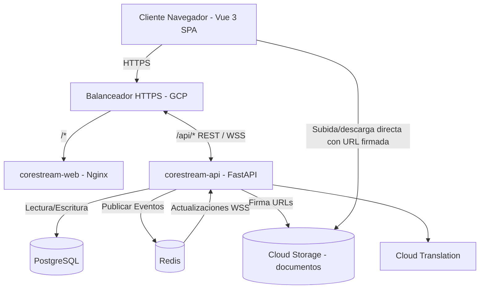

# Arquitectura de CoreStream

CoreStream es una plataforma de gestión de proyectos y tickets para equipos de desarrollo. Utiliza una arquitectura moderna y desacoplada con un frontend en Vue 3 y un backend en FastAPI.

## Resumen del Stack

| Capa | Tecnología |
|---|---|
| **Frontend** | Vue 3 + TypeScript + Vite + Pinia + Tailwind CSS |
| **Backend** | FastAPI (Python 3.11) |
| **Base de Datos** | PostgreSQL 15 |
| **Caché / Mensajería** | Redis 7 |
| **Tiempo Real** | WebSockets (vía pub/sub de Redis) |
| **Archivos** | Google Cloud Storage con URLs firmadas |
| **Traducción** | Google Cloud Translation v3 |
| **Infraestructura** | GCP: Cloud Run (front y API) detrás de un balanceador HTTPS, VM con Postgres + Redis |
| **Observabilidad** | Logging JSON para Cloud Logging (`severity`, `request_id`, enlace a la traza de la petición) + métricas nativas de Cloud Run |

## Flujo del sistema

PostgreSQL y Redis corren en la misma VM privada (`corestream-data`); front y
API en Cloud Run, que escala a cero. Detalle de la infraestructura en
[`DEPLOYMENT.md`](./DEPLOYMENT.md).

## 1. Frontend (Vue 3)

El frontend es una Single Page Application (SPA) construida con la Composition API de Vue 3 y empaquetada con Vite. En producción se sirve como build estática con un Nginx sin privilegios (`nginx-unprivileged`, puerto 8080) en su propio contenedor, el servicio de Cloud Run `corestream-web` (no el servidor de desarrollo de Vite, que rechaza hosts no incluidos en su allowlist). El Nginx define la CSP (incluye `https://storage.googleapis.com` en `connect-src` para las subidas directas al bucket), la caché de estáticos y el fallback de la SPA.

- **Gestión de estado**: Pinia (`authStore`, `ticketsStore`, etc.).
- **Enrutamiento**: Vue Router, con un guard `beforeEach` asíncrono que espera a `authStore.ensureInitialized()` antes de decidir si redirigir.
- **Estilos**: Tailwind CSS.
- **Cliente HTTP**: Axios (`services/api.ts`), con `withCredentials: true` para la cookie de refresh y un interceptor que renueva el access token en un 401.
- **Tiempo real**: composable `useWebSocket` (estado a nivel de módulo, no por instancia) que abre la conexión tras obtener un ticket de un solo uso — ver sección de seguridad. Incluye el corte por inactividad (ver sección 4).

## 2. Backend (FastAPI)

El backend provee endpoints RESTful y conexiones WebSocket, asíncrono de punta a punta.

- **Capa de enrutamiento**: separada por dominios (`auth`, `tickets`, `epics`, `notifications`, `invitations`, etc.), bajo `app/routers/`.
- **Capa de servicios**: lógica de negocio en `app/services/` (máquina de estados de tickets, permisos, notificaciones, timers, traducción de documentos).
- **Acceso a datos**: SQLAlchemy 2.0 async ORM + asyncpg. Todas las relaciones usan `lazy="raise_on_sql"` (ver `app/models/base.py`) — un lazy-load olvidado falla ruidosamente en desarrollo y en CI en vez de convertirse en un 500 silencioso en producción.
- **Validación**: Pydantic v2, con `max_length` en los campos de texto de entrada.
- **Esquema de base de datos**: gestionado únicamente por Alembic. `alembic upgrade head` corre una vez por despliegue (Cloud Run Job `corestream-migrate`; servicio `migrate` en docker compose), no al arrancar cada contenedor; si falla, el despliegue se detiene.
- **Notificaciones**: se guardan en PostgreSQL y, tras el commit, la API las publica directo en Redis (`notification_service.publish_notification`, con timeout de 2 s para no bloquear la request si Redis no responde). No hay worker separado: ARQ se eliminó en la migración a GCP.
- **Documentos**: los bytes nunca pasan por la API (`app/services/storage.py`). Subida en 3 pasos: `POST /api/documents/upload-url` → `PUT` directo al bucket con la URL firmada (15 min, a `pending/<uuid>`) → `POST /api/documents/confirm` (mueve a `documents/<uuid>`). Descarga con `GET /api/documents/{id}/download-url` (URL de 5 min). El límite de 25 MB va firmado en la propia URL (`x-goog-content-length-range`): lo aplica Cloud Storage, no solo el cliente. Las URLs se firman con IAM `signBlob` usando la cuenta de servicio de Cloud Run, sin claves descargadas. En desarrollo y tests, `STORAGE_BACKEND=local` imita lo mismo en disco.
- **Traducción de documentos**: Google Cloud Translation v3 (`app/services/translation_service.py`), autenticada con las credenciales del entorno (en Cloud Run, la cuenta de servicio; en local, `gcloud auth application-default login`). Sin credenciales responde 503 "no configurada".
- **Logs**: JSON a stdout en el formato de Cloud Logging (`severity`, `request_id`, `logging.googleapis.com/trace`), con el `request_id` propagado incluso en respuestas 500. Sin Prometheus.
- **Servidor**: uvicorn con 1 worker por contenedor (Cloud Run escala por instancias, no por procesos) y pool de 5 + 5 conexiones a Postgres por instancia.

## 3. Base de datos (PostgreSQL)

Entidades clave:

- `users`, `roles`, `invitations` (alta de usuarios por invitación, no registro público)
- `applications`, `epics`, `tickets`, `subtasks`
- `ticket_events` (auditoría de las transiciones de estado)
- `notifications`
- `incidents`, `meetings` (soporte operativo y ceremonias de equipo)

## 4. Pub/Sub en tiempo real (Redis)

Redis sirve como columna vertebral para las funciones en tiempo real. Todos los canales y claves llevan el prefijo `corestream:` — el pub/sub de Redis **no** está aislado por índice de base de datos (`db N`), así que si la VM llega a compartir Redis con otro proyecto, el prefijo es la única barrera real.

Cuando cambia el estado de un ticket:

1. El backend guarda el cambio en PostgreSQL.
2. Se publica un evento en un canal de Redis (`corestream:tickets:updates` o `corestream:user:{id}:notifications`).
3. Las conexiones WebSocket activas reciben la carga JSON y actualizan el frontend.

El WebSocket usa dos tareas de larga vida coordinadas (una escuchando Redis, otra al cliente) con `asyncio.wait(..., return_when=FIRST_COMPLETED)` — el diseño anterior recreaba tareas en cada iteración de un bucle sin timeout real, lo que saturaba la CPU con conexiones inactivas.

**Corte por inactividad.** En Cloud Run, un WebSocket abierto mantiene una instancia encendida (y facturando), aunque nadie mire la pestaña:

- El front muestra "¿Sigues ahí?" a los 10 min sin actividad (`components/common/IdlePrompt.vue`) y cierra el socket con código 4000 a los 5 min siguientes. No reconecta solo: el usuario pulsa "Reconectar".
- Mientras hay actividad, el front envía `{type: 'activity'}` como máximo una vez por minuto. Los ping/pong automáticos no cuentan.
- Respaldo en el backend: si no recibe actividad en `WS_IDLE_TIMEOUT_SECONDS` (20 min), cierra con 4000.
- Tras cualquier reconexión se emite `ws-resync` en el eventBus, y las vistas que consumen `ws-update` recargan sus datos (pudieron perderse eventos mientras estaba desconectado).

## 5. Seguridad y autenticación

- **Tokens**: JWT de acceso (corta duración, en memoria del store de Pinia — nunca en `localStorage`) y de refresco (httpOnly, `SameSite=Strict`, solo viaja a `/api/auth/refresh`). Llevan un claim `type` (`access`/`refresh`) y un `jti` para poder revocarlos individualmente en logout.
- **CSRF**: patrón de doble envío (cookie legible `csrf_token` + cabecera `X-CSRF-Token`) en toda mutación que dependa de la cookie de refresh.
- **WebSocket**: se autentica con un ticket de un solo uso de 15s (`POST /api/auth/ws-ticket`), no con el JWT en el query string — evita que el token quede en los logs de acceso de un proxy.
- **Autorización (RBAC)**: `ADMIN`, `TEAM_LEADER`, `DEVELOPER`. Además de rol, hay comprobación de pertenencia (`app/services/ticket_permissions.py`): un `DEVELOPER` solo actúa sobre tickets que tiene asignados. Matriz completa en [`RBAC.md`](./RBAC.md).
- **Contraseñas**: bcrypt con un pre-hash SHA-256 (evita el límite de 72 bytes de bcrypt sin truncar la contraseña real).
- **Rate limiting**: contador en Redis por IP y por cuenta sobre `/auth/login`. La IP real del cliente se toma de `X-Forwarded-For` contando desde la derecha (`XFF_CLIENT_POSITION`; detrás del balanceador de GCP es la penúltima, posición 2), no de la primera entrada, que el cliente puede falsear.
- **Infraestructura**: la API y el front solo aceptan tráfico que llega por el balanceador (ingress `internal-and-cloud-load-balancing`). La VM de datos no tiene IP pública: Postgres y Redis solo se alcanzan desde la subred de Cloud Run, y la administración es por IAP. Los secretos viven en Secret Manager, no en las imágenes.
- **Alta de usuarios**: sin registro público — el primer ADMIN se crea con un script de un solo uso (`app/scripts/create_admin.py`); el resto, por invitación.

## 6. Empaquetado y despliegue

Las mismas dos imágenes sirven en todos lados:

- `backend/Dockerfile` — uvicorn en `$PORT` (8080), 1 worker, sin access log. **No corre migraciones al arrancar**: `alembic upgrade head` corre una vez por despliegue, en el Cloud Run Job `corestream-migrate` (o en el servicio `migrate` de docker compose).
- `frontend/Dockerfile` — build de Vite servida por `nginx-unprivileged` en el puerto 8080.

**Producción (GCP):** Cloud Run `corestream-api` y `corestream-web` detrás de un balanceador HTTPS global (`/api/*` → API, resto → web), VM `corestream-data` con Postgres y Redis, buckets `corestream-file` (documentos) y `corestream-backups` (respaldos). Ver [`DEPLOYMENT.md`](./DEPLOYMENT.md).

**Docker Compose** (dos ficheros que se combinan, no uno con condicionales), solo para trabajo local:

- `docker-compose.yml` — perfil de producción: imágenes construidas, servicio `migrate` antes del backend. No levanta Postgres ni Redis: hay que darle `DATABASE_URL` y `REDIS_URL`. Sirve para probar las imágenes tal cual se despliegan.
- `docker-compose.dev.yml` — overlay de desarrollo: bind mounts, recarga en caliente, servidor de Vite, sus propios Postgres/Redis descartables y `STORAGE_BACKEND=local`.

Ver [`SETUP.md`](./SETUP.md) para desarrollo local.
