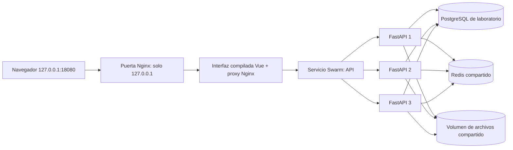

# TRV-09 — Escalabilidad con contenedores y orquestación

## Objetivo y alcance acordado

Laboratorio local reproducible con Docker Swarm de un nodo. Escalamiento manual
del backend de una a tres réplicas, distribución de solicitudes, reemplazo
automático de contenedores fallidos y datos compartidos. No requiere una cuenta
de nube ni acceso a la infraestructura de Alloxentric. No modifica los datos
ni los servicios de desarrollo de localhost:5173.

La documentación GCP existente describe infraestructura previa de la empresa;
no constituye evidencia del trabajo realizado en este requisito.

## Arquitectura del laboratorio



Los servicios API, web, PostgreSQL y Redis están administrados por Swarm.
La puerta de entrada es un contenedor auxiliar con publicación de puerto solo
en la interfaz local: los servicios Swarm no publican puertos. Así se evita
exponer el laboratorio en todas las interfaces mediante la malla de ingreso.

API: imagen sin recarga ni carpetas de código montadas; usuario sin privilegios.
Las etiquetas de imagen incluyen una huella de su contenido para que Swarm
detecte los cambios de versión.
La cabecera `X-CoreStream-Instance` identifica la réplica únicamente en esta
imagen de demostración; no se añade al backend normal.

## Decisiones y límites

- Escalar API, no duplicar bases de datos independientes: todas las réplicas
  consultan la misma información y comparten Redis para sesiones/notificaciones.
- Archivos compartidos en el volumen del nodo. Esto funciona en este laboratorio;
  para varios equipos se requiere almacenamiento externo, como GCS ya soportado.
- Restricción de ubicación `corestream.trv09=true` sobre el nodo local: no se
  presenta este almacenamiento como una solución distribuida.
- Cada API: máximo 384 MB, 0,75 CPU, pool de 2 conexiones + 1 adicional.
  Tres réplicas: hasta 9 conexiones; actualización gradual: hasta 12. PostgreSQL
  admite 50 conexiones en este laboratorio. Estos límites no prueban capacidad
  productiva ni sustituyen mediciones.
- Comprobaciones de salud de API incluyen PostgreSQL y Redis; se reutiliza
  `/api/health`. Swarm mantiene la cantidad deseada y reemplaza contenedores.
- Migraciones ejecutadas una vez antes de iniciar las réplicas; sin migraciones
  concurrentes durante cada arranque. Cuenta demo creada explícitamente.
- Actualizaciones de una réplica a la vez, con reversión configurada al fallar.
  Esto configura una política; no equivale a probar todas las actualizaciones
  futuras ni asegura cero interrupciones.
- No se reintentan escrituras automáticamente en Nginx: evitar duplicaciones
  cuando una respuesta se pierde después de confirmar una operación.
- Escalamiento manual; no hay escalamiento automático por demanda.
- Un único equipo: no hay alta disponibilidad ante caída del nodo, PostgreSQL,
  Redis o el volumen. Las conexiones en curso pueden fallar durante un incidente.
- HTTP local, entorno `demo`; no se relajan las validaciones del entorno de
  producción. No usar esta configuración para publicar en Internet.

## Uso desde PowerShell

Abrir una terminal en la carpeta `Evidencia de sistema Aplicacion`:

```powershell
# Construye imágenes, habilita Swarm si hace falta e inicia el laboratorio.
.\deploy\trv09\trv09.ps1 -Action Start

# Consulta servicios y tareas.
.\deploy\trv09\trv09.ps1 -Action Status

# Aumenta manualmente a tres réplicas.
.\deploy\trv09\trv09.ps1 -Action Scale -Replicas 3

# Prueba una réplica, tres réplicas y recuperación de una réplica detenida.
.\deploy\trv09\trv09.ps1 -Action Verify

# Detiene exclusivamente el laboratorio. Conserva datos, archivos y secretos.
.\deploy\trv09\trv09.ps1 -Action Stop
```

Si la política de PowerShell impide ejecutar scripts, se puede invocar ese
archivo con `powershell -ExecutionPolicy Bypass -File ...` para esa ejecución;
no es necesario cambiar permanentemente la política del equipo.

Dirección: `http://127.0.0.1:18080/#/login`.
Cuenta: `admin.trv09@example.org`.
Usar 127.0.0.1 separa las cookies de las que usa localhost:5173.
Contraseña generada: archivo `deploy/trv09/.local/demo_password`. Es exclusiva de
esta demostración; no se reutilizan las credenciales de la base normal.

Swarm requiere Docker con contenedores Linux. Se habilita en el motor local;
no se deshabilita al detener el laboratorio porque puede alojar otros servicios.
No se eliminan volúmenes. No borrar `.local`: contiene las claves de los datos
persistentes. Los archivos `.local` y `reports` están excluidos de Git y de las
imágenes. Los secretos se montan mediante Docker Secrets; las credenciales no
están escritas en el YAML ni en el código.

## Validación y evidencias

`Verify` crea únicamente datos de prueba del laboratorio y realiza, por etapa,
120 lecturas autenticadas de un ticket con concurrencia 6. Registra errores,
mediana, p95, solicitudes por segundo y número de solicitudes por instancia.
También descarga un archivo original desde todas las réplicas y renueva la
sesión. Después detiene un contenedor de API y exige que Swarm lo sustituya
por uno distinto, antes de repetir la prueba funcional.

Resultados JSON en `deploy/trv09/reports/` y listado de tareas en `tareas.txt`.
No contienen contraseñas ni tokens. Sirven para repetir y comparar la prueba,
no para prometer una cantidad de usuarios productivos ni una mejora fija de
rendimiento: las réplicas comparten el mismo computador y sus recursos.

Para la presentación: mostrar `Status`, escalar de 1 a 3, mostrar las instancias,
explicar los datos compartidos y presentar el informe de recuperación. El resumen
de la ejecución validada se registra en `TRV-09-resultados.md`.
